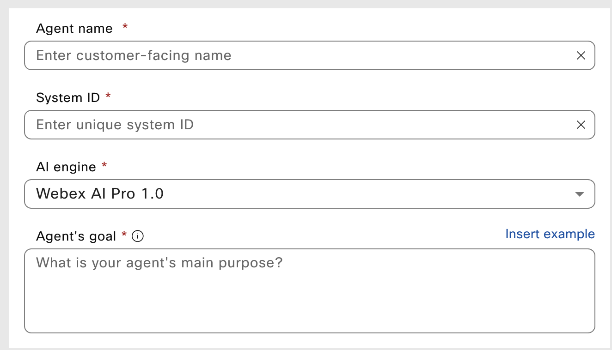
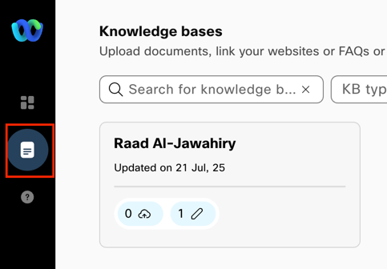
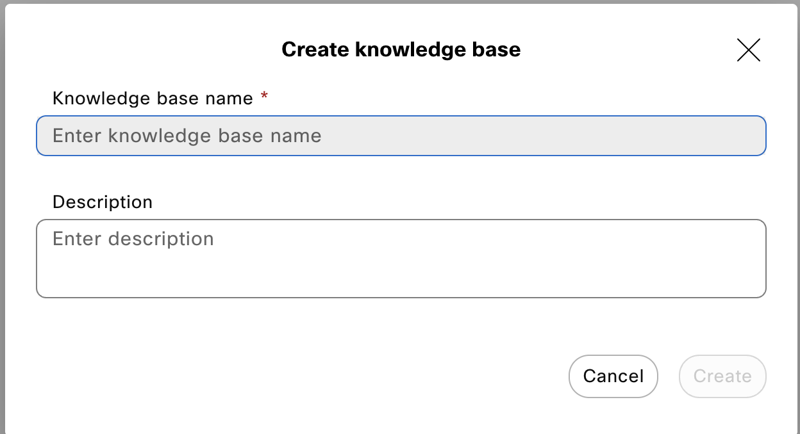
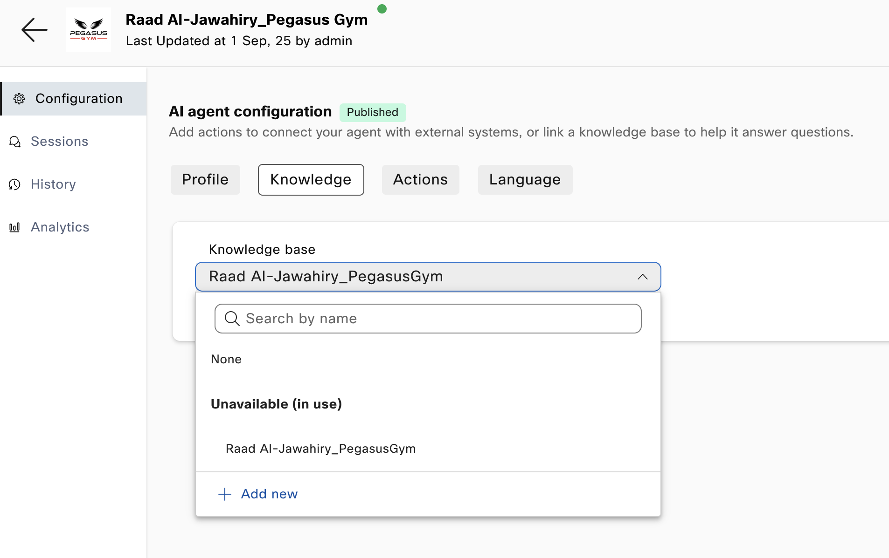

## **Step 1: Initial Setup**

1. Login to **Webex Control Hub (**[**https://admin.webex.com**](https://admin.webex.com)**)**
2. Go to **Contact Center > AI Agents.**
3. Select **Build your AI Agent,**
4. In the top right of the screen select **+ Create agent.**
5. You will see a list of templates. For today lets select **Start from scratch** and then **Next**
6. Now select **Autonomous**
7. Complete the configuration below:
   * **Agent name** (Make this your name\_business)
   * **AI engine** (Set to **Webex AI Pro 1.0)**
   * **Agent Goal** (Describe what this AI Agent will do)
8. Click **Create**

## **Step 2: AI Agent Configuration**

1. Under **AI Agent Configuration** click on **Profile**
2. Complete the **Instructions** field with step by step instructions for your agent to accomplish its goals  
   Example:  
   *- Summarize the user's request and ask them to confirm that you understood correctly.  
   - If necessary, seek clarifying details.  
   - Thank the user for their business and say goodbye.*
3. Complete the **Welcome Message** field with the first message you want the AI Agent to say
4. Click **Save Changes**

## **Step 3: Build Knowledge Base**

1. Click on **Knowledge**  
   
2. Click **+ Create Knowledge Base  
   **
3. Enter a **Knowledge Base Name** (Make this your name) and then **Create**
4. In **Files** you can drag and drop pdf, docx, txt, xlsx, xls or csv documents you want the AI Agent to learn and answer the customers query with
5. In **Documents** you can click **+ Create Document**
6. Give it a **Document name** and then **Add to new category** and give the category a name
7. In the document you can copy and paste any information you want the AI Agent to know about including images and flash pages

## **Step 4: AI Agent Knowledge & Actions**

* Go to **Dashboard**
* Locate your **AI Agent** and click on it
* Click on **Knowledge** and find your **Knowledge base** from the drop down menu  
  
* Click **Save changes**
* Click **Actions** and then **+New action**
  + **Action Name** – Call it customer\_information
  + **Action description** – explain to the AI Agent that this is the questions to ask the user if they are interested in signing up
  + **Action Scope** – Select **Slot Filling and fulfillment**
* Under **Slot Filling** click **+ New input Entity**
  + **Entity name** – name the field such as **Customer\_Name**
  + **Entity type** – Select from the drop down menu the type of data you are gathering (Select **String** if its just customer name)
  + **Entity description** – In plain text enter a description of the field
  + **Required** – Set this to **Yes**
* Repeat the previous step for all the information you want to collect from the customer
* Under “**Webex Connect Flow Builder Fulfillment**”
  + **Select Service** – Set this to Webex\_One\_2025
  + **Select Flow** – Set this to AI Agent
  + Optional extra step is to go to <https://raljawah1xsw.us.webexconnect.io/> and create your own service
* Select **Save**
* Once completed select **Publish**
* Got to **Language** and select the language you would like your AI Agent to speak/chat in
* Select **Save Changes**

## **Step 5: Testing & Q&A**

* In **Dashboard** select your AI Agent
* Click **Preview** (Located top right of the screen)
* Select **Start a chat** or **Start a call**
* Edit **profile**, **knowledge** and **Actions** as required to make it perfect
* Congratulations you are now a AI Developer!

**Helpful Resources**

* [Webex AI Agent Documentation](https://help.webex.com/)
* [Webex Contact Center Developer Guide](https://developer.webex.com/)
* [Cisco Webex Community](https://community.cisco.com/)
